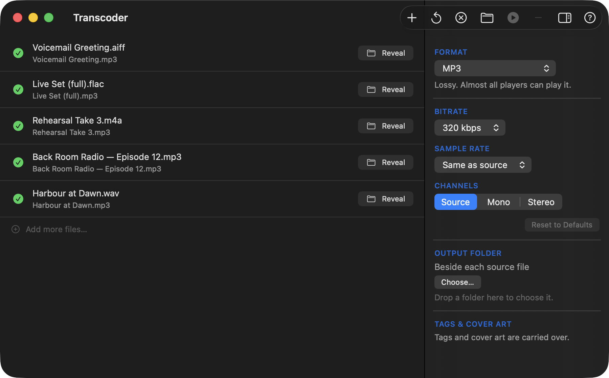

# Transcoder
### Audio Converter for macOS

<p align="center">
  <strong>Version:</strong> 0.2.0
  <br />
  <a href="https://github.com/sevmorris/Transcoder/releases/latest/download/Transcoder-v0.2.0.dmg"><strong>Download Latest (DMG)</strong></a>
  ·
  <a href="https://sevmorris.github.io/Transcoder/manual/">Manual</a>
  ·
  <a href="https://sevmorris.github.io/Transcoder/theory.html">Theory of Operation</a>
</p>

<p align="center">
  
</p>

A macOS app that converts audio: drop files in, pick a format, convert. Audio only — from a video file it takes the first audio track and writes nothing else.

- **Formats:** MP3, AAC (M4A), Apple Lossless (M4A), FLAC, WAV, AIFF, Opus (OGG).
- **Presets per format:** bitrate for the lossy formats, bit depth for the lossless ones, sample rate and channels for all (or "same as source"). Each format remembers its own.
- **Batch queue:** add files or whole folders; per-file progress, cancel, Convert Again, and Reveal in Finder.
- **Metadata:** tags and cover artwork are carried through. WAV and Opus keep the tags but have no place FFmpeg can put a cover.
- Outputs go beside each source or into a chosen folder, and never overwrite: a taken name gets a number.

Requires macOS 15.0 or later on Apple Silicon.

## Building

```bash
./scripts/fetch-ffmpeg.sh
xcodebuild -project Transcoder.xcodeproj -scheme Transcoder -configuration Release -destination 'generic/platform=macOS'
```

```bash
xcodebuild -project Transcoder.xcodeproj -scheme Transcoder test
```

The tests include an end-to-end conversion of a tagged sample with cover art to every format, run through the bundled FFmpeg in a temporary folder. A test run never touches the app's real settings: hosting tests, the app starts with no window, and `UserDefaults.app` is a scratch suite.

### Screenshots

The pictures in `docs/screenshots/` come from the app itself:

```bash
xcodebuild -project Transcoder.xcodeproj -scheme Transcoder -configuration Release -destination 'generic/platform=macOS' -derivedDataPath build
```

```bash
build/Build/Products/Release/Transcoder.app/Contents/MacOS/Transcoder --snapshot docs/screenshots
```

It opens the window in dark mode, fills the queue with made-up rows for each state (waiting, converting, completed, failed), sets the format each picture needs, captures the window with `screencapture -l`, and quits. Nothing is converted. The settings go to a scratch suite, not the app's real settings. The run needs a 2x display, and Screen Recording permission for the app you start it from, such as Terminal. Leave the keyboard and mouse alone while it runs: the window must stay the active window, or the run stops and says so. If the window's size or layout changes, check the `width` and `height` of each picture in `docs/manual/index.html`. The list of shots is in `Transcoder/Snapshot.swift`.

## Licence

MIT (see `LICENSE`). The bundled FFmpeg is LGPL; see `Vendor/README.md`.
